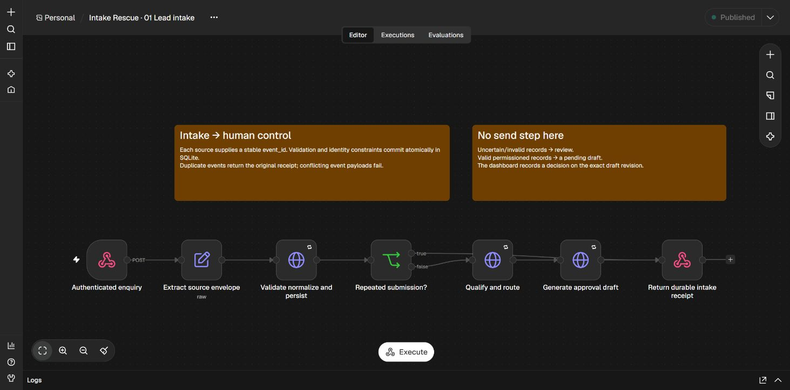

# Intake Rescue

A working Sparrow Works demonstration of reliable enquiry intake, human-approved follow-up and recovery using **n8n + Python + SQLite**. All fixtures are synthetic. Delivery writes to a local simulator; no real email service is connected.

**[Watch the captioned two-minute live demonstration](portfolio/Intake-Rescue-Two-Minute-Demo.mp4)** — genuine browser footage of intake, duplicate prevention, explicit approval, HTTP 503 recovery and one simulated receipt. The edit shortens idle time and is labelled throughout. [Recording evidence](portfolio/recording-evidence.json).

**Verified on 9 November 2026:** 49 automated tests passed; 14 real n8n integration scenarios passed; an actual application-process termination recovered through n8n with one simulator receipt. Chrome review, correction, approval and rejection were exercised. See [test results](docs/TEST-RESULTS.md) and [evidence](evidence/).



## What it does

- Accepts authenticated webhooks from distinct sources using one JSON contract.
- Normalises email/UK phone formats; holds invalid, incomplete or ambiguous enquiries for review.
- Enforces event idempotency, catches changed payloads under reused IDs, and links contacts across sources.
- Uses conservative deterministic rules for booking, sales, support, recruitment and other enquiries.
- Creates revision-bound drafts. A recorded approval of the exact draft is required before an outbox row exists.
- Recovers unfinished intake stages and expired delivery leases; retries 429/5xx/transport failures with bounded backoff.
- Provides a protected local console with corrections, approvals, contact history, retry evidence and dead-letter controls.

## Quick start: Windows without Docker

Prerequisites: Python 3.10+ (tested 3.10.11), Node.js 24 (tested 24.14.0), npm. Use a fresh directory for this repository.

```powershell
python -m venv .venv
.venv\Scripts\python -m pip install -r requirements.lock.txt
.venv\Scripts\python scripts\init_env.py
powershell -File scripts\install-n8n.ps1
.venv\Scripts\python scripts\n8n_local.py import
```

Start the two services in separate terminals:

```powershell
.venv\Scripts\python scripts\serve.py
```

```powershell
.venv\Scripts\python scripts\n8n_local.py start
```

Open the [n8n editor](http://127.0.0.1:5678) and complete its **local** owner setup. Use a synthetic `.test` email and a unique password; a cloud account and activation key are unnecessary. The import script has already activated the four local workflows. In n8n 2.x the CLI calls this operation “publish”; it only activates them on this loopback instance.

Open the [operations console](http://127.0.0.1:8765). Enter an operator name and `IR_ADMIN_TOKEN` from your local `.env`. Tokens remain in tab memory and disappear on reload/lock. Do not share your `.env` or n8n state directory.

```powershell
.venv\Scripts\python scripts\submit_sample.py
.venv\Scripts\python scripts\submit_sample.py
.venv\Scripts\python scripts\submit_sample.py review-enquiry.json
.venv\Scripts\python scripts\submit_sample.py no-permission.json
```

The first sample creates a pending draft. The second returns the same lead as a duplicate. Review and approve through the console; n8n dispatches within the next 5-second tick. To demonstrate a fault without racing the scheduler, choose **Temporary failure, then recover** before clicking **Approve simulated reply**. That fault plan and the outbox row commit together.

Use `--new-event` to create another synthetic demonstration enquiry; it changes both event ID and message. Changing only the event ID with identical content from the same source intentionally remains a duplicate.

## Docker Compose

Docker is **not installed in the verification environment**, so the Compose deployment is supplied but has not been runtime-tested. The npm installation above was genuinely run.

```sh
python scripts/init_env.py
docker compose up --build -d
```

Compose starts the app, a one-shot n8n credential/workflow initializer, then n8n. Ports 8765 and 5678 bind to host loopback. Named volumes retain the application database and n8n encryption/state. Complete local n8n owner setup in the browser. Do not run Compose and the direct local services on the same ports simultaneously.

`docker compose down` preserves volumes. `docker compose down -v` destroys them; do not use it for normal shutdown. For upgrades/import changes, stop n8n, rerun the initializer and restart it; see the handover guide. This Compose configuration is for a local demonstration, not a public deployment template.

## Tests and evidence

```powershell
.venv\Scripts\python -m pytest -q --junitxml=evidence\unit-tests.xml
# With both services running and the workflows activated:
.venv\Scripts\python scripts\verify_n8n.py
```

The runtime verifier submits synthetic webhooks, approves selected drafts as a named test operator, injects faults, waits for real n8n schedules and independently audits committed SQL records. Run against disposable/local synthetic state; each run uses a new prefix. The SQL audit assumes the direct local `IR_DATABASE` path; for Compose use the container's database or copy a consistent backup for audit.

The process-restart verifier deliberately terminates the app PID **you supply** and starts its replacement. Use only on this demonstration service:

```powershell
.venv\Scripts\python scripts\verify_process_restart.py <app-server-pid>
```

It proves the accepted-before-acknowledgement crash window against the real n8n recovery scheduler. It leaves the replacement local app running and writes its PID to `.runtime/app.pid`.

## Repository map

| Location | Contents |
|---|---|
| `app/domain.py` | Transactional identity, intake, approval, outbox and simulator rules |
| `app/main.py` | Role-protected API and local HTTP delivery adapter |
| `app/migrations/001_initial.sql` | Idempotent initial schema and migration marker |
| `app/static/` | Dependency-free operations console |
| `n8n/` | Four importable, credential-free workflow exports |
| `scripts/` | Setup, generation, sample submission, verification and packaging |
| `tests/`, `samples/` | Automated synthetic scenarios and reusable payloads |
| `evidence/` | JUnit results, observed runtime reports and genuine screenshots |
| `docs/` | Architecture, API contract, security, operations and portfolio materials |

Read [architecture](docs/ARCHITECTURE.md), [API contract](docs/API.md), [security and failure modes](docs/SECURITY-AND-FAILURES.md), [operational handover](docs/HANDOVER.md), [known limitations](docs/LIMITATIONS.md), [portfolio case study](docs/CASE-STUDY.md), [two-minute demonstration](docs/DEMO.md), and [client explanation](docs/CLIENT-EXPLANATION.md).

This is a public portfolio source repository; the demonstration application remains local. n8n is a separately licensed dependency; its runtime is excluded from the source archive.
