# Architecture

## System boundary

Intake Rescue demonstrates the parts of an automation contract that need to remain dependable when requests repeat, APIs fail or an execution stops. n8n is the primary orchestrator. A small Python service provides transactional boundaries, a local dashboard and a simulated provider.

```mermaid
flowchart LR
    Sources[Website / partner / event forms] --> Hook[Authenticated n8n webhook]
    Hook --> Envelope[Extract envelope]
    Envelope --> Intake[Validate / normalise / persist]
    Intake --> Duplicate{Repeated submission?}
    Duplicate -->|yes| Receipt[Original durable receipt]
    Duplicate -->|no| Qualify[Qualification and review routing]
    Qualify --> Draft[Permission gate and draft]
    Draft --> Receipt
    Draft --> Console[Human operations console]
    Console --> Approval[Revision-bound approve / reject]
    Approval --> Outbox[(SQLite outbox)]
    Timer[n8n 5-second delivery schedule] --> Claim[Atomic claim + lease]
    Outbox --> Claim
    Claim --> Adapter[Loopback HTTP delivery adapter]
    Adapter --> Simulator[(Simulated idempotency receipts)]
    Adapter --> Outcome{Result}
    Outcome --> Sent[Sent]
    Outcome --> Retry[Backoff / retry / dead-letter]
    Recovery[n8n recovery schedule] --> Unfinished[Resume unfinished stages / expire leases]
    Errors[n8n Error Trigger] --> Ledger[Redacted failure ledger]
```

The canvas has distinct native Webhook, Set, HTTP Request, If, Split Out, Schedule Trigger, Respond to Webhook, Error Trigger and terminal nodes. The implementation does not wrap an entire orchestration in one HTTP request. Each stage can be inspected and retried independently. API calls encapsulate business rules where a database transaction is essential.

## Four workflows

1. **01 Lead intake:** authenticate, extract the source envelope, validate/normalise/persist, branch on duplicate, qualify, generate a draft and return the original intake receipt. The receipt's `state` is the state at persistence time; the detail API/dashboard exposes the current state after later stages.
2. **02 Interrupted intake recovery:** every five seconds, expire stale delivery leases, fetch up to 50 unfinished received/qualified records, split them and resume qualification/draft creation. Review, rejected and no-permission records are excluded.
3. **03 Approved delivery and retries:** every five seconds, atomically claim one eligible outbox row, split the job, invoke the delivery adapter and expose sent versus retry/dead-letter branches. Delivery retries are scheduled in SQLite, not held inside a long n8n wait.
4. **04 Orchestration error ledger:** n8n's Error Trigger stores workflow ID, execution ID and node name. It excludes raw exception strings, request headers and enquiry text.

The recovery and delivery canvases also offer worker-authenticated manual webhook ticks. There is no Python timer driving normal processing; stopping n8n stops orchestration while persisted state remains available.

## Database invariants

- `UNIQUE(source,event_id)` prevents repeated event creation. A different payload under the same source/event yields 409.
- A SHA-256 fingerprint over normalised fields plus source catches identical submissions under fresh event IDs. Aliases persist in `duplicates`. Cross-source enquiries retain their own lead records and share a contact.
- Email and phone uniqueness is database-enforced. Matching two different contacts, or changing an established email/phone pair, causes `identity_conflict`; records are not silently merged.
- `UNIQUE(lead_id,revision)` freezes one draft per version. Pending/rejected drafts are superseded on correction. An old revision cannot be approved.
- One approval decision exists per draft. Repeating the same decision is idempotent; changing it yields 409.
- `UNIQUE(draft_id)` in the outbox prevents repeated approvals creating repeated sends. Approval, outbox creation and any synthetic fault plan commit atomically.
- Claims use `BEGIN IMMEDIATE`, a lease token and deadline. Only the current unexpired token can read a delivery payload or commit its result.
- The simulator stores one receipt per stable outbox ID. Concurrent calls return the original receipt; changed payloads under the same key conflict.

SQLite uses WAL, foreign keys and a 15-second busy timeout. Each mutation gets its own connection and short write transaction. HTTP provider calls happen outside the database transaction, so a slow integration does not hold a write lock. The initial migration is repeatable and records version 1. No destructive schema upgrades are bundled.

## State transitions

Intake: `received → qualified → awaiting_approval → queued → sent`.

Exceptions: invalid/ambiguous identity or category → `review`; no reply permission → `no_permission`; rejected draft → `rejected`; exhausted/permanent delivery failure → `failed`. Correcting an unapproved record increments its revision and returns it to review or qualification. Approved records are locked against recipient/message edits.

Outbox: `queued → processing → sent | retry | dead`. An expired processing lease becomes retry, or dead when its automatic budget is exhausted. Default backoff is 5, 10 and 20 seconds before attempts 2–4. Retry-After numeric seconds can extend that delay up to one hour. Permanent 4xx errors go directly to dead; 429 is retryable. A dead-letter can be reconciled against an existing simulator receipt or explicitly redriven by an admin with a fresh four-attempt budget. Attempt history is retained; the outbox `attempts` counter is per budget.

## Assumptions and tradeoffs

- Low-volume, single-machine demonstration; no distributed filesystem or network-mounted SQLite.
- Phone numbers default to UK `+44` only when supplied in domestic leading-zero form. Other countries need explicit international format.
- Email case-folding is a practical business identity rule, not a claim about every mail server's local-part semantics.
- Boolean `permission_to_reply: true` is required. It is source-provided permission for this specific enquiry; the system does not infer a marketing subscription or legal basis.
- Keyword rules favour review over false confidence. Multiple matching categories or no match become Other with review required. An operator can explicitly select Other.
- Same-source identical normalised content is deduplicated for as long as retained. A real deployment should agree a time window and genuine-repeat handling with its client.
- No AI dependency, SMTP account, third-party CRM, public endpoint or paid infrastructure is needed.

## Technical references

The pinned runtime is n8n 2.46.7, verified locally. Setup follows n8n's [npm installation documentation](https://docs.n8n.io/hosting/installation/npm/) and [server CLI documentation](https://docs.n8n.io/hosting/cli-commands/). Local imports require care with fixed workflow IDs: these scripts are intended for a dedicated instance, because importing those IDs into another instance can overwrite workflows with the same IDs.
